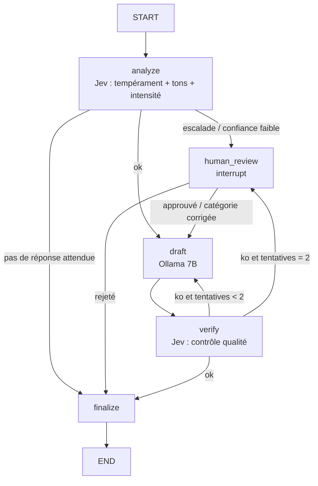

# Plan — Agent « Tempérament » (LangGraph · Jev · Ollama · Langfuse)

## 1. Objectif

Un agent qui reçoit un texte (un email en texte brut) et :
1. **détecte son tempérament** (catégorie principale, tons secondaires, intensité) ;
2. **explique sa décision** (probabilités, confiance, règle de routage appliquée) ;
3. **propose une réponse adaptée** au tempérament détecté ;
4. **demande une validation humaine** quand la décision est incertaine ou sensible ;
5. affiche tout cela dans une **interface web** qui montre le chemin suivi dans le graphe.

Le tout se lance avec un `docker compose up`, **on-premise**. Seule exception au 100 % local : **Jev** (API TypeSafe hébergée), utilisé pour les décisions.

## 2. Répartition des rôles

| Brique | Rôle | Pourquoi ce choix |
|---|---|---|
| **LangGraph** | orchestration : état, routage, boucle, pause humaine, persistance | flux non linéaire (boucle de vérification, HITL), historique rejouable pour l'UI |
| **Jev** (TypeSafe) | **toutes les décisions** : tempérament, tons, intensité, besoin de réponse, contrôle qualité de la réponse | sorties typées + probabilités calibrées, 70–500 ms, ne génère pas de texte |
| **Ollama 7B** | **génération** de la réponse (et rien d'autre) | local ; un 7B rédige correctement mais décide mal → on ne lui confie aucune décision |
| **Langfuse** | traces, latences, annotation des runs | auto-hébergeable, intégration LangChain/LangGraph native |
| **Postgres** | checkpointer LangGraph (reprise, HITL, historique) | survit aux redémarrages, contrairement à `InMemorySaver` |

Règle de conception : **le code décide de la politique, Jev fournit les jugements, le 7B écrit**.

## 3. Les catégories de tempérament (10 + repli)

| id | Libellé | Description envoyée à Jev (à affiner) |
|---|---|---|
| `joyeux` | Heureux / enthousiaste | Exprime de la joie, de l'excitation ou une bonne nouvelle |
| `reconnaissant` | Reconnaissant | Remercie, félicite ou exprime de la gratitude |
| `neutre` | Neutre / factuel | Transmet une information ou une demande sans émotion marquée |
| `inquiet` | Inquiet / anxieux | Exprime une crainte, un doute ou un besoin d'être rassuré |
| `triste` | Triste / déçu | Exprime de la peine, de la déception ou du découragement, sans hostilité |
| `frustre` | Frustré / impatient | Agacé par un problème qui dure, des relances ou une attente, ton encore courtois |
| `enerve` | Énervé / en colère | Colère explicite : reproches directs, majuscules, ponctuation excessive |
| `moqueur` | Moqueur / sarcastique | Ironie ou dérision ouverte ; le sens réel est l'inverse du sens littéral |
| `passif_agressif` | Passif-agressif | Politesse de façade qui cache un reproche (« comme déjà indiqué… », « merci d'avance de bien vouloir enfin… ») |
| `hostile` | Hostile / menaçant | Menaces, insultes, ultimatums, intimidation |
| `autre` | Indéterminé | Aucun tempérament ci-dessus ne s'applique (texte vide, hors sujet, message automatique) |

Les paires faciles à confondre (`moqueur` / `passif_agressif`, `frustre` / `enerve`, `triste` / `inquiet`) auront des **descriptions sous forme d'objet avec exemples et contre-exemples**, comme le recommande la doc Jev.

## 4. Questions posées à Jev

**Un seul appel `system_one`** par texte : les questions indépendantes partent ensemble, en parallèle.

`state` = `{ "email": { "subject": ..., "body": ... } }`

| id question | Primitive | Contenu | Usage |
|---|---|---|---|
| `temperament` | **Choice** (11 options) | « Quel est le tempérament dominant de l'auteur de `email.body` ? » | catégorie principale, distribution affichée dans l'UI |
| `ton_<id>` × 10 | **Noul** | « Le texte exprime-t-il, même secondairement, <description> ? » | tons secondaires (multi-label) ; ex. *frustré + passif-agressif* |
| `intensite` | **Score** (4 niveaux décrits par des situations) | de « émotion à peine perceptible » à « émotion qui domine tout le message » | jauge UI, ajuste le ton de la réponse |
| `attend_reponse` | **Noul** | « L'auteur attend-il une réponse ou une action ? » | sinon : pas de brouillon |
| `escalade` | **Noul** | « Le texte contient-il une menace, une mise en demeure ou un risque juridique ou de sécurité ? » | force la revue humaine |

**Vérification de la réponse générée** (second appel Jev, après Ollama). `state` = email + brouillon.
- Nouls : `reponse_polie`, `reponse_reconnait_emotion`, `reponse_ne_promet_rien_d_invente`, `reponse_sans_sarcasme`, `reponse_traite_la_demande`.
- Politique dans le code : si un critère est < 0,5, réécriture avec le feedback (2 fois au maximum), puis revue humaine.

**Politique de routage** (seuils de départ, à calibrer à l'étape 9) :
- `escalade` > 0,5 ou `temperament == hostile` → **revue humaine obligatoire**
- `temperament.confidence` < 0,5 → **revue humaine** (l'UI montre les deux catégories en tête)
- `attend_reponse` < 0,3 → **pas de réponse** (classification seule)
- sinon → **rédaction automatique**

Les réponses Jev **brutes** sont stockées dans l'état : changer un seuil recalcule la politique sans rappeler le modèle.

## 5. Le graphe LangGraph



- **État** (`TypedDict`) : `email`, `analysis`, `route_reason`, `draft`, `verification`, `attempts`, `human_decision`, `final`. Chaque node renvoie un patch de l'état.
- **Persistance** : `PostgresSaver` (`langgraph-checkpoint-postgres`). Un run = un `thread_id`. `interrupt()` dans `human_review`, reprise via `Command(resume=...)`. L'UI s'appuie sur `get_state_history()` pour la timeline et l'audit.

## 6. Génération locale (Ollama)

- Modèle par défaut : **`qwen2.5:7b-instruct`** (bon niveau en français, sait suivre un schéma JSON). Alternative : `mistral:7b-instruct`. Configurable via `OLLAMA_MODEL`.
- Client : `langchain-ollama` (`ChatOllama`) avec sortie structurée `{subject, body}` → les appels apparaissent automatiquement dans Langfuse.
- Un **prompt par tempérament** avec une stratégie de réponse explicite : *énervé* → reconnaître, s'excuser sans se justifier, proposer une action ; *passif-agressif* → répondre au fond, rester factuel, ne pas relever la pique ; *moqueur* → ignorer l'ironie, traiter la demande ; *inquiet* → rassurer avec des faits ; etc.
- Garde-fous : `temperature` basse, longueur maximale, interdiction d'inventer des engagements (dates, montants). C'est ensuite contrôlé par Jev dans `verify`.

## 7. API (FastAPI) — contrat pour le front

| Méthode | Route | Rôle |
|---|---|---|
| `POST` | `/runs` | `{subject?, body}` → `{thread_id}` et lancement du graphe |
| `GET` | `/runs/{id}/events` | **SSE** : un événement par node terminé (`graph.astream(stream_mode="updates")`) |
| `GET` | `/runs/{id}` | état courant, statut (`running`, `waiting_human`, `done`), lien vers la trace Langfuse |
| `GET` | `/runs/{id}/history` | checkpoints successifs (timeline, audit) |
| `POST` | `/runs/{id}/resume` | `{action: approve, edit ou reject, temperament?, reply?}` |
| `GET` | `/runs` | liste des runs (filtre par statut ou tempérament) |
| `GET` | `/graph` | nodes et edges (`app.get_graph()`) pour dessiner le graphe |
| `GET` | `/health` | état d'Ollama, de Jev, de Postgres et de Langfuse |

On n'utilise **pas** LangGraph Server/Platform : son déploiement auto-hébergé en production demande une licence. Une API FastAPI suffit et reste sous contrôle.

## 8. Interface (React + Vite, servie par nginx)

- **Saisie** : zone de texte, quelques exemples préchargés.
- **Graphe en direct** (React Flow) : les nodes s'allument au fil des événements SSE, et le chemin réellement suivi est surligné (boucles de réécriture comprises).
- **Panneau « Pourquoi »** :
  - barres de probabilité sur les 11 tempéraments + confiance ;
  - pastilles des tons secondaires (Nouls > 0,5) ;
  - jauge d'intensité ;
  - raison du routage en clair (« revue humaine : confiance 0,38 entre *frustré* et *passif-agressif* ») ;
  - résultats du contrôle qualité de chaque brouillon.
- **Brouillon** éditable. En cas de pause humaine : boutons Approuver / Modifier / Rejeter et choix de la catégorie corrigée.
- **Historique** des runs, et lien « voir la trace » vers Langfuse.

Note : Jev ne produit pas d'explication textuelle. L'explication vient des **probabilités, des tons et de la règle de routage appliquée**, ce qui est factuel et non une justification inventée après coup. Piste v2 pour surligner les passages décisifs : découper l'email en phrases et poser à Jev un Noul par phrase (« cette phrase exprime-t-elle <tempérament> ? »).

## 9. Docker Compose

```
services:
  ui              nginx + build React            :8080
  api             FastAPI + LangGraph            :8000
  ollama          ollama/ollama                  :11434  (profil "ollama", volume modèles)
  ollama-init     pull du modèle au premier démarrage, puis s'arrête
  postgres        checkpointer LangGraph + base Langfuse (deux bases)
  langfuse-web    :3000            ┐
  langfuse-worker                  │ profil "observability"
  clickhouse                       │ (désactivable pour une
  redis                            │  machine modeste)
  minio                            ┘
```

- **Un seul `.env`** : `TYPESAFE_API_KEY`, `OLLAMA_BASE_URL`, `OLLAMA_MODEL`, seuils de routage, secrets Langfuse.
- **Langfuse sans clic** : variables `LANGFUSE_INIT_*` pour créer l'organisation, le projet et les clés API au premier démarrage. L'`api` se connecte avec `LANGFUSE_BASE_URL=http://langfuse-web:3000`.
- **GPU** : bloc `deploy.resources.reservations.devices` pour NVIDIA sur Linux. **Sur macOS, Docker n'a pas accès au GPU** : on lance Ollama nativement (Metal) sans le profil `ollama`, et l'`api` pointe sur `http://host.docker.internal:11434`.
- **Ressources** : Langfuse recommande 4 cœurs et 16 Go à lui seul ; un 7B en q4 prend environ 5 Go. **Cible : 32 Go de RAM**, ou 16 Go sans le profil `observability`.
- Commande unique : `make up` (= `docker compose --profile ollama --profile observability up -d`).

## 10. Arborescence

```
docker-compose.yml  .env.example  Makefile  README.md
api/
  pyproject.toml                # langgraph, langgraph-checkpoint-postgres, langchain-ollama,
                                # typesafe-sdk, langfuse, fastapi, uvicorn, pydantic-settings
  app/
    config.py                   # seuils, modèles, URLs
    temperaments.py             # les 11 catégories + descriptions Jev + stratégies de réponse
    jev/questions.py            # construction des questions (analyse, vérification)
    jev/client.py               # AsyncTypeSafeClient, RetryPolicy, traçage @observe Langfuse
    llm/ollama.py               # ChatOllama + prompts de réponse
    graph/state.py  nodes.py  routing.py  build.py
    api/routes.py  sse.py
    main.py
  tests/                        # Jev et Ollama simulés : routage, boucle bornée, HITL, reprise
  eval/
    dataset.jsonl               # textes FR annotés {text, temperament, tons[]}
    run_eval.py                 # précision, matrice de confusion, calibration des seuils
ui/
  src/ (pages Run, History ; composants GraphView, WhyPanel, DraftEditor)
  Dockerfile  nginx.conf
```

## 11. Étapes de développement

| # | Étape | Livrable | Critère de fin |
|---|---|---|---|
| 0 | **Spike Jev en français** (avant tout le reste) | script et 30 textes FR annotés | précision par catégorie connue → **go / no-go** |
| 1 | Squelette compose | `ollama`, `postgres`, `api /health`, `ui` « hello » | `make up` fonctionne sur une machine vierge |
| 2 | Node `analyze` | questions Jev + politique de routage + tests | tests verts, sortie lisible en CLI |
| 3 | Node `draft` | ChatOllama + prompts par tempérament | réponse en FR cohérente sur les 30 textes |
| 4 | Graphe complet + HITL | `PostgresSaver`, `interrupt`, `resume` | un run en pause survit à `docker compose restart api` |
| 5 | Node `verify` + boucle | contrôle Jev, 2 réécritures au maximum | boucle bornée testée |
| 6 | API + SSE | routes du §7 | flux d'événements consommé par `curl -N` |
| 7 | Langfuse | profil compose + traces (graphe, nodes, Ollama, Jev) | un run = une trace complète, liée depuis l'UI |
| 8 | UI | §8 | démo de bout en bout, y compris une pause humaine |
| 9 | Éval et calibrage | `eval/run_eval.py`, ~100 textes | seuils fixés d'après les mesures, rapport dans `EVAL.md` |

## 12. Risques et points d'attention

1. **Jev est d'abord entraîné en anglais.** La doc dit que les autres langues sont gérées « mais pas aussi bien », sans citer le français. C'est le principal risque, d'où l'étape 0. Si les résultats sont insuffisants : décrire les options en anglais tout en gardant le texte en français (à tester en premier), ou traduire localement avec Ollama (plus lent, source d'erreurs).
2. **Données hors site** : le texte des emails part vers l'API TypeSafe. C'est à valider côté conformité et RGPD (conservation, sous-traitance). Il faut prévoir si besoin un mode « masquage » (emails, téléphones, noms remplacés avant l'envoi).
3. **Accès Jev en early access** : clé API à obtenir, limites de débit non documentées publiquement. Gérer `TypeSafeAPIError` avec un `RetryPolicy`, et passer en revue humaine si Jev est indisponible (jamais de décision prise par le 7B en secours).
4. **Ambiguïté intrinsèque** : sarcasme et passif-agressif sont difficiles même pour un humain. Viser un bon calibrage (savoir dire « je ne sais pas ») plutôt qu'une précision parfaite.
5. **Qualité d'un 7B** : correcte pour rédiger, inégale pour respecter strictement les consignes. D'où le contrôle Jev et la limite de réécritures.
6. **Lourdeur de Langfuse v3** (6 conteneurs) : profil désactivable.

## 13. Vérification

- `make test` : tests unitaires et tests de graphe, sans réseau (Jev et Ollama simulés).
- `make up`, puis ouvrir `http://localhost:8080`, coller un email passif-agressif et vérifier : graphe animé, probabilités affichées, brouillon proposé.
- Email ambigu → pause humaine ; `docker compose restart api` ; reprise depuis l'UI.
- Trace complète visible sur `http://localhost:3000`.
- `make eval` → `EVAL.md` avec la matrice de confusion et les seuils retenus.

## 14. Décisions à confirmer

- **Front** : React + React Flow (proposé). Alternative plus rapide : Streamlit, au prix d'une visualisation moins riche.
- **Modèle de génération** : `qwen2.5:7b-instruct` ou `mistral:7b-instruct`.
- **Machine cible** : GPU NVIDIA, Mac, ou CPU seul (ce qui change la latence de génération : quelques secondes avec GPU, 30 s et plus en CPU).
- **Sortie de l'agent** : brouillon affiché seulement (proposé), ou envoi réel par email (hors périmètre pour l'instant).
